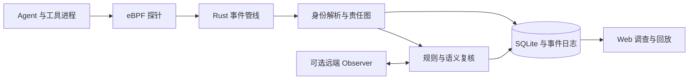

<div align="center">
  
  <h1>MtAgentLens</h1>
  <p><strong>零插桩 · 内核级 · 多 Agent 攻击可观测性</strong></p>
  <p>从运行事实到责任链，让 Agent 的行为有据可查。</p>
  <p>
    <a href="#系统架构"></a>
    <a href="collector/"></a>
    <a href="frontend/"></a>
    <a href="#许可证"></a>
  </p>
  <p>
    <a href="#快速开始">快速开始</a> ·
    <a href="docs/architecture.md">架构</a> ·
    <a href="compare/results/README.md">实验结果</a> ·
    <a href="datasets/FuxiBench/README.md">FuxiBench</a> ·
    <a href="docs/README.md">文档</a>
  </p>
</div>

## 项目介绍

MtAgentLens 是面向 LLM Agent 的 **OS 级可观测与责任分析系统**。它通过 eBPF 采集 TLS 明文、进程、文件、网络和 stdio 事件，在 Rust Collector 中关联身份与行为，并通过内嵌 Web 控制台呈现证据和调查路径。接入核心采集通路无需修改目标 Agent 代码或集成 SDK。

一次 Agent 任务可能跨越多个 worker、工具进程和交接文件。MtAgentLens 将这些分散的执行事实关联起来，帮助回答：**谁执行了操作、涉及哪些资源、上下文如何传播、告警依据在哪里。**

| 能力 | 提供什么 |
|---|---|
| 跨层采集 | TLS 请求与响应、进程生命周期、文件与网络操作，以及指定进程的 stdio 载荷 |
| 选择性身份解析 | 结合进程代际、TLS 会话与 conversation 信号，在证据支持时赋予关联身份 |
| 责任图与来源追踪 | 关联 Agent、动作和资源，保留跨进程传播与权限边界线索 |
| 分层分析 | 结合规则、图事实和可配置的 Observer 语义复核，输出结构化裁决 |
| 调查与回放 | 使用 SQLite、事件日志和 Web 界面查看运行、证据、告警及离线分析 |

核心路径提供观测和分析，不拦截 Agent 操作。当前主要验证对象为 **Linux 上的 Claude Code**；其他 Agent 的支持范围与配置见[能力清单](docs/capabilities.json)和[采集说明](bpftools/README.md)。

## 功能演示

[](https://github.com/LiuZhouKang/MtAgentLens/blob/main/docs/materials/demo/demo.mp4)

[观看完整演示（约 1 分 48 秒）](https://github.com/LiuZhouKang/MtAgentLens/blob/main/docs/materials/demo/demo.mp4)：采集、责任图、结构化告警与证据回溯。演示原件与讲解保留在 [docs/materials/demo](docs/materials/demo/)。

## 系统架构



- **采集层**：`tls_capture`、`process`、`stdiocap` 分别处理 TLS、进程及相关系统行为、stdio；系统资源从 `/proc` 采样。
- **分析层**：Runner 与 Analyzer 完成事件接入、HTTP/SSE 解析、时间归一化、脱敏、身份关联和责任分析。
- **交付层**：eBPF helper 和前端静态资源在构建时嵌入 `mtagentlens` 二进制；运行结果保留在本地数据库与日志中。

具体职责、来源等级、Observer 数据边界和数据库契约见[架构文档](docs/architecture.md)。

## 快速开始

### 1. 获取源码并构建

需要具备 BTF 的 Linux 内核（最低前置条件为 5.8）、Rust 1.85+、Node.js 22.13.0+，以及 clang/LLVM、libelf、zlib、OpenSSL、zstd 开发库。内核与 TLS 库兼容性需在目标环境验证。

```bash
git clone --recurse-submodules https://github.com/LiuZhouKang/MtAgentLens.git
cd MtAgentLens

./install.sh       # 检查并安装构建依赖，按提示确认
make check
make build        # eBPF → 前端 → Rust
```

产物为 `collector/build/release/mtagentlens`，构建依赖包含 `libbpf/` 和 `bpftool/` 两个子模块。完整环境与开发流程见[开发与维护](scripts/README.md)。

### 2. 检查环境并启动采集

以下示例适用于 `claude` 命令指向实际 ELF 可执行文件的安装方式：

```bash
sudo ./collector/build/release/mtagentlens doctor

sudo ./collector/build/release/mtagentlens record -c claude \
  --binary-path "$(readlink -f "$(command -v claude)")"
```

在另一终端运行 Claude Code，浏览器打开 **http://127.0.0.1:7395**。采集结束时按 `Ctrl+C`，等待终结化与写入完成。

`--binary-path` 应指向承载 SSL 实现的 ELF 文件；脚本包装器、其他运行时和非 Claude 进程需要按[探针说明](bpftools/README.md)调整。eBPF 加载需要 root 或环境允许的相应 capabilities，以 `doctor` 的实际诊断为准。

### 3. 选择分析模式

默认路径会尝试加载 Observer 配置。需要真实语义复核时，参考[配置模板](env/config/observer.toml.example)配置 provider；也可显式关闭 Observer：

```bash
sudo ./collector/build/release/mtagentlens record -c claude \
  --binary-path /absolute/path/to/agent-elf \
  --disable-responsibility-observer
```

关闭 Observer 使用无模型回退路径，与完整语义分析的结果范围不同。配置了远端 Observer 后会产生 API 请求，并发送限额任务上下文；启用前阅读[数据与安全边界](docs/security/threat-model.md)。

## 常用命令

| 命令 | 用途 |
|---|---|
| `doctor` | 检查内核、权限与采集前置条件 |
| `record` | 使用预设过滤条件采集并启动 Web 服务 |
| `trace` | 按需组合 TLS、process、stdio、system 来源 |
| `ssl` / `process` / `stdio` | 单独检查相应采集来源 |
| `system` | 采样 CPU 与内存 |
| `export-genai` | 从责任数据库导出 GenAI spans，默认不含内容 |
| `replay-sensitivity` | 对已记录 checkpoint 进行离线参数回放 |

运行 `./collector/build/release/mtagentlens <命令> --help` 查看实际参数。`trace --capture-only` 可用于仅采集对照；完整操作见[采集说明](bpftools/README.md)。

## FuxiBench 与实验

[FuxiBench](datasets/FuxiBench/README.md) 提供 **93 个场景：58 个攻击、35 个良性**，覆盖间接／不可信指令驱动攻击（A 类 47 个）和多 Agent／交接权限攻击（B 类 11 个）。场景、fixture、标签与来源记录按场景组织，支持跨层可观测性研究。

| 实验 | 内容 | 入口 |
|---|---|---|
| 检测 | 93 场景，分别报告 ITT、PP 与良性误报 | [检测结果](compare/results/detection/README.md) |
| 身份 | 30 个多 Agent 场景，展示选择性赋值及 precision–coverage 特征 | [IdentityBench](compare/results/identity/README.md) |
| 开销 | Collector 稳态、探针执行和完整系统组件分账 | [开销结果](compare/results/overhead/README.md) |
| 消融与敏感性 | 组件贡献、工作点与参数扰动 | [消融](compare/results/ablation/README.md) · [敏感性](compare/results/sensitivity/README.md) |
| 外部比较与归因 | 基线输入范围、比较结果及归因输出可评分状态 | [外部基线](compare/results/external/baselines/README.md) · [归因](compare/results/attribution/README.md) |

**开销实测。** 在固定本地受控负载、每次 60 s 的三次稳态测量中，Collector 进程树的单核平均 CPU 为 **0.661%**。该值包含 Rust Collector 和两个采集子进程；真实 Agent＋Observer 的完整系统成本另行分账，具体负载、窗口与原始记录见[开销报告](compare/results/overhead/README.md)。

标签来自 AI 盲标与裁决，来源与评价范围见[数据卡](datasets/FuxiBench/DATASET-CARD.md)。实验数字以对应批次为准；仅克隆源码不包含全部大体积运行数据库、图表和实验原始数据。查看与复现前请阅读[交付说明](compare/results/README.md)和[复现手册](docs/evaluation/REPRODUCE.md)。

## 项目导航

| 路径 | 职责 |
|---|---|
| [bpftools/](bpftools/) | eBPF 程序与用户态加载器 |
| [collector/](collector/) | Rust 采集、身份解析、责任分析、持久化与服务 |
| [frontend/](frontend/) | Next.js / React 调查界面 |
| [datasets/FuxiBench/](datasets/FuxiBench/) | 数据集、标签、场景与证据来源 |
| [env/](env/README.md) | 场景执行与验证环境 |
| [compare/](compare/README.md) | 实验代码、结果说明与交付入口 |
| [docs/](docs/README.md) | 系统文档、论文、审稿意见及比赛／演示原件 |
| [scripts/](scripts/README.md) | 开发流程、离线门禁、审计与发布 |

修改前阅读[开发与维护](scripts/README.md)，先验证受影响模块，提交前运行：

```bash
./scripts/verify.sh
```

Web/API 默认仅监听回环地址且没有内置鉴权；数据库与捕获日志应按敏感数据管理。安全报告、脱敏范围与部署要求统一见[威胁模型](docs/security/threat-model.md)。

## 引用

```bibtex
@software{mtagentlens2026,
  author = {刘周康 and MtAgentLens contributors},
  title = {{MtAgentLens}: Zero-Instrumentation Multi-Agent LLM Attack Observability with eBPF},
  year = {2026},
  url = {https://github.com/LiuZhouKang/MtAgentLens}
}
```

数据集引用信息见 [FuxiBench/CITATION.cff](datasets/FuxiBench/CITATION.cff)。

## 许可证

- **项目代码**：[Apache-2.0](LICENSE-APACHE) 或 [MIT](LICENSE-MIT) 双许可。
- **eBPF 与加载器**：保留各文件头许可。`process.bpf.c`、`stdiocap.bpf.c` 为 GPL-2.0 OR BSD-3-Clause；`tls_capture.bpf.c` 与三个用户态加载器为 LGPL-2.1 OR BSD-2-Clause。
- **FuxiBench 数据**：[CC-BY-4.0](datasets/FuxiBench/LICENSE)。
- **技术文档与演示材料**：[CC BY-SA 4.0](https://creativecommons.org/licenses/by-sa/4.0/deed.zh)。

第三方组件 [libbpf](https://github.com/libbpf/libbpf) 与 [bpftool](https://github.com/libbpf/bpftool) 保留上游版权及许可，具体以各目录与文件声明为准。
