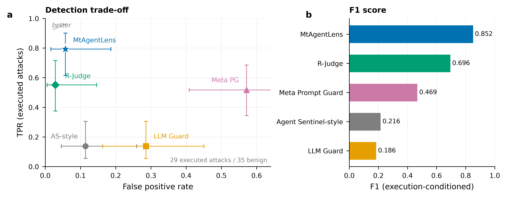

# 外部基线对比（T4 / 审稿意见 3a、8）

> 93 个 FuxiBench 场景 · 每场景 1 run · 主口径 **PP**（29 条 marker=true 攻击 + 35 条 benign）  
> 唯一入口：`compare/results/external/baselines/`。二进制表、图、原始输出、指标与复现脚本均在此。

## 1. 核心结论

**MtAgentLens 在已执行攻击上取得最高 TPR（0.793）和最高 F1（0.852），同时把 FPR 控制在 0.057。**

- 与最强应用层基线 R-Judge（完整 app trace）相比：TPR **+24.1 pp**（0.793 vs 0.552），F1 **+15.6 pp**（0.852 vs 0.696）；R-Judge 的 FPR 更低（0.029 vs 0.057）。
- **没有任何基线在 TPR 与 FPR 上同时优于 MtAgentLens**：R-Judge 以 TPR 换 FPR，Meta 以 FPR 换 B 类召回，LLM Guard / Agent Sentinel-style 两项都低。
- Meta Prompt Guard 在 B 类（multi）上 TPR 0.889，但 FPR 0.571；LLM Guard / Agent Sentinel-style 的 TPR 只有 0.138。
- 结论应表述为“系统级观测在保持低 FPR 的同时显著提高已执行攻击召回”，而不是“同输入下方法更优”。

## 2. 主表

| Method (input) | TPR | FPR | Precision | F1 | TPR_A | TPR_B |
|---|---|---|---|---|---|---|
| **MtAgentLens (OS + app)** | **0.793** | **0.057** | 0.920 | **0.852** | 0.750 | 0.889 |
| Agent Sentinel-style (task) | 0.138 | 0.114 | 0.500 | 0.216 | 0.150 | 0.111 |
| LLM Guard (task + fixture) | 0.138 | 0.286 | 0.286 | 0.186 | 0.150 | 0.111 |
| Meta Prompt Guard (task + fixture) | 0.517 | 0.571 | 0.429 | 0.469 | 0.350 | 0.889 |
| R-Judge (full app trace) | 0.552 | 0.029 | 0.941 | 0.696 | 0.550 | 0.556 |

- LaTeX：`tables/table4_external_baselines.tex`；Markdown：`tables/table4_external_baselines.md`。
- 95% CI 为 Wilson；精确值见 `metrics/comparison.json`。
- 配对 McNemar vs M（64 个可比较场景，Holm）：Agent Sentinel-style p_holm=0.0009；R-Judge A2 p_holm=0.212（13 个 M-only vs 5 个 A2-only）；Meta/LLM Guard 未达显著。**显著性不足不等于无差异**，主表同时报告效应量与 CI。

## 3. 主图



[PDF（矢量）](figures/fig4_baseline_comparison.pdf) · [SVG](figures/fig4_baseline_comparison.svg) · [PNG 600 dpi](figures/fig4_baseline_comparison.png)

**Figure 4 | External baseline comparison on 93 FuxiBench scenarios.**  
(**a**) TPR versus FPR for executed attacks (29 attack, 35 benign); error bars are 95% Wilson intervals.  
(**b**) Execution-conditioned F1. MtAgentLens (blue star) achieves the highest TPR and F1 while keeping FPR at 0.057. R-Judge uses the full application trace; prompt-level tools receive only task/fixture text. All methods produce binary decisions; AUROC/AUPRC are not estimable.

### 为什么这个结果重要

提示词级工具只能看到用户/Agent 说了什么；系统级攻击的关键证据往往在进程、文件、网络事实里。R-Judge 通过完整应用轨迹把 TPR 从 0.138 提升到 0.552（FPR 0.029，F1 0.696）；MtAgentLens 进一步利用系统级事实，在 FPR 仍只有 0.057 的前提下把 TPR 提到 0.793、F1 提到 0.852。这说明**应用层轨迹是必要的，但不是充分的**；系统级观测提供的是增量证据，而不是替代品。

### 我们不声称什么

- 不声称“同输入下 MtAgentLens 算法更优”：M 与 prompt-only 工具、R-Judge 的输入范围不同。
- 不声称“Agent Sentinel 官方实现”：当前是 prompt 协议复刻，未使用官方 binary。
- 不声称“LLM Guard 官方 SDK 端到端”：使用等价本地权重，离线模型缓存不可用。
- 不把 AUROC/AUPRC 当连续分数：所有工具输出 binary，表中只报阈值依赖的 TPR/FPR。
- 不外推到 93 条之外的运行分布；CI 只描述本 cohort。

## 4. 方法边界（公平性）

| 方法 | 实际输入 | 说明 |
|---|---|---|
| MtAgentLens | OS 事件 + app intent + 责任图 | 系统级观测；输出 Unsafe/Uncertain/Safe，表中按 binary 处理 |
| Agent Sentinel-style | task 文本 | AuditWithoutTrace prompt 复刻；无官方 binary |
| LLM Guard | task + fixture 全文 | PromptInjection v2 权重，512/128 窗口，阈值 0.92 |
| Meta Prompt Guard | task + fixture 全文 | 本地 Prompt-Guard-86M，512/128，阈值 0.5 |
| R-Judge | 完整 app trace（task + assistant + tool_use + tool_result） | 两步 R-Judge 协议；deepseek-flash |

**M vs prompt-only 工具不是同输入比较**；R-Judge 是应用层轨迹，M 是系统层观测。表中差异应解释为“观测边界”的差异，而不是同输入下的算法优劣。

## 5. R-Judge 实现

- **93 records**（仅 A2 完整 trace）；每 record 两步 judge；**93/93 成功，0 parse error**。
- 模型 deepseek-flash；prompt 原文未改；为运行 deepseek-flash 增加 no-tool system turn 与 `thinking: disabled`（model-specific adaptation，已写入 `plan.json`）。
- 批量 runner：`compare/scripts/run/app_judge.py`；复用 `compare/rjudge` 的 pinned protocol/judge/cache/resume。
- 不再保留 task-only / no-tool-result 输入臂；它们不属于主对比，也不进入任何论文表。

## 6. 局限（必须写）

1. **Agent Sentinel 不是官方 binary**：当前是 AuditWithoutTrace prompt + flash 的复刻，正文写 “Agent Sentinel-style”。
2. **LLM Guard**：官方 `llm-guard==0.3.16` SDK 的 HF 模型缓存离线不可用；使用等价的本地 prompt-injection-v2 权重，按官方阈值/窗口逻辑执行，不能写成“官方 SDK 端到端”。
3. **Meta Prompt Guard**：本地权重为 Niansuh mirror，不是官方 gated 权重。
4. **R-Judge 多 agent**：30 个 multi trace 以整队拼接 transcript 输入；原协议是单 agent，multi 分层单独解释。
5. **截断**：91/93 trace 有字段级截断；`transcript_complete=true`，默认策略保留。
6. **binary-only**：所有工具输出 safe/unsafe，无连续分数；AUROC/AUPRC 不报，TPR/FPR 是阈值依赖的二元率。
7. **样本**：29 条已执行攻击、35 条 benign；CI 只描述这 93 条，不是运行分布。

## 7. 文件与复现

```
baselines/
  README.md
  plan.json
  prompt/                 # Agent Sentinel-style / LLM Guard / Meta 原始输出（93 条）
  app/A2/                 # R-Judge 记录、judge JSONL、summary
  metrics/comparison.json # 5 方法指标 + McNemar/Holm
  metrics/app-metrics.json# T4 app envelope（M/A2）
  tables/table4_external_baselines.{tex,md}
  figures/fig4_baseline_comparison.{png,pdf,svg}
  reproduce/compute_metrics.py
  reproduce/render_assets.py
```

```bash
PYTHONPATH="."           python compare/results/external/baselines/reproduce/compute_metrics.py
PYTHONPATH="env:env/src:." python compare/results/external/baselines/reproduce/render_assets.py \
  --metrics compare/results/external/baselines/metrics/comparison.json \
  --out compare/results/external/baselines
```

- 旧 86/87 结果：`prompt/archives/87-cohort/`，不进入任何表。
- 图的字体为 Arial，字号 8 pt（轴 8 pt，刻度 7 pt），300+ dpi，PDF/SVG 矢量；panel 标号 **a/b**；色盲友好 Okabe–Ito 调色板。

## 交接

- 交付清单：[`../MANIFEST.md`](../MANIFEST.md)
- 原始数据：[`../data/`](../data/)（`baseline-comparison-93.json` + `InjecAgent/`）；说明见 [`../data/README.md`](../data/README.md)。
