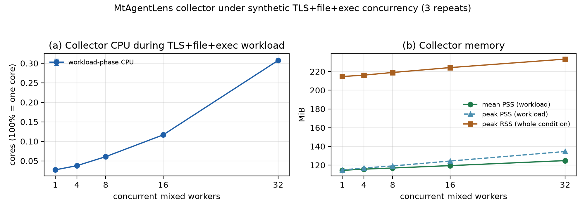

# MtAgentLens 开销实验：结果、图表与原始数据

> **统一入口 · 审稿意见 5 · 整理日期：2026-10-29**  
> 完整系统实验：2026-10-28 冻结批次；Collector 稳态补测：2026-10-29。两者的负载和测量窗口不同，分别解释。本文及下列文件取代此前分散在 `local/` 和 `docs/evaluation/` 的开销结果入口。

## 1. 先看结论

**固定本地负载下，Collector 稳态单核 CPU 均值为 0.661%，三次均低于 5%。** 这个结果包含 Rust Collector 和两个采集子进程，支持限定采集负载下的低 CPU 占用；不代表完整系统或任意真实 Agent 流量均低于 5%。

- **探针执行较轻**：TLS BPF 执行均值 873.35 ns／成功 SSL 读写操作，三个重复范围 386.68–1133.54 ns。它不等于完整采集延迟。
- **完整系统有真实成本分账**：并发 1 的完整系统每条件消耗 0.85 CPU·s、峰值 RSS 376.04 MiB，真实 Observer 费用上界 $0.005232／条件。
- **高并发仍有边界**：32 并发存在来源丢弃、资源上升和证据关联覆盖不足；不能表述为全并发零丢失或完整系统始终低于 5%。

- **合成并发补充（2026-11-01，非 Agent）**：同一 C1 稳态负载扩展到 32 并发时，
  Collector 稳态 CPU 约 0.31 个逻辑核、平均 PSS 124.8 MiB、受控文件与 TLS 事件零
  丢弃；真实 Agent + Observer 的完整系统表见 §3.2（2026-10-28 冻结批次）。两项
  测量的处理阶段与负载不同，不能合并。详见下文。

**推荐阅读顺序：本页 → [综合图](figures/overhead_compact.pdf) → [完整分账表](tables/component_accounting.md) → 按需下载 CSV。**

## 2. 图：稳态成本、完整系统资源与关联覆盖


[PDF（论文排版）](figures/overhead_compact.pdf) · [SVG（可编辑矢量）](figures/overhead_compact.svg) · [PNG（预览）](figures/overhead_compact.png)

**图注。** A：固定本地负载下三次独立运行的 Collector CPU 轨迹。每约 5 s 由累计 CPU 时间差除以实际窗口时长计算，不插值、不平滑；CPU 100% 表示占满一个逻辑核。图内报告全程平均 CPU 与 5% 平均 CPU 目标。B：真实 Agent＋Observer 完整系统批次的平均单核 CPU 与平均峰值 RSS，包含启动与收尾，每档三个独立重复。C：受控文件捕获覆盖与成功凭据动作的 evidence 关联覆盖，后者标明分子／分母。B、C 的并发档位等距排列。A 与 B 的负载不同，不计算直接性能改善倍数。

**制图规格。** 恢复原来的 13 × 3.8 英寸宽幅布局、彩色稳态轨迹、均值标注与图内图例。DejaVu Sans；PDF 嵌入 TrueType 字体，SVG 保留可编辑文本，PNG 为 300 dpi。

**补充图（2026-11-01，合成并发）。** 另一张图给出同一 C1 稳态负载扩展到 1/4/8/16/32
并发时的 Collector CPU 与内存（TLS+file+exec，无模型调用），见
[figures/synthetic_concurrency_mixed_2026-11-01.png](figures/synthetic_concurrency_mixed_2026-11-01.png)
与下文“合成并发稳态测量”。它与本图 A/B 的负载、处理阶段和窗口不同，不能互相换算。

## 3. 表：Collector 稳态与完整系统分账

### 3.1 Collector 稳态

| 独立重复 | 有效窗口 | CPU 时间 | 单核平均 CPU | 平均 PSS／RSS（MiB） | 成功受控文件缺失 | 成功子进程 EXEC 捕获 |
|---|---:|---:|---:|---:|---:|---:|
| 1 | 60.000 s | 0.40 s | 0.667% | 111.38／213.32 | 0／600 | 60／60 |
| 2 | 60.000 s | 0.40 s | 0.667% | 111.00／213.02 | 0／600 | 60／60 |
| 3 | 60.000 s | 0.39 s | 0.650% | 111.12／213.05 | 0／600 | 60／60 |
| 三次均值 | 60.000 s | 0.397 s | **0.661%** | **111.17／213.13** | **0／1,800（合计）** | **180／180（合计）** |

**条件与质量。** 每秒 10 次双向 TLS echo（40 次成功 SSL 读写，256 B／次）、10 次唯一文件操作、1 次 `/bin/true` 执行，固定速率持续 60 s。每次独立启动、等待两类探针就绪后计时；包括三个采集进程的用户态、系统态及已回收子进程 CPU，未计入负载程序本身。没有在测量前后额外加入静默时段来稀释 CPU。BPF 累计统计开关为 0，TLS／Process 来源终态丢弃计数均为 0。

**适用范围。** 固定 TLS 载荷不是 HTTP。每次完成 2,400 次 SSL 操作，但 trace 输出为 1,200 个读载荷记录、1,200 个 incomplete 协议诊断及健康记录；不能把来源零丢弃解释为所有原始操作载荷逐一完整留存，更不能据此声称真实 LLM HTTP/SSE 解析完整。未设置无监测配对对照，因此本补测不估算被观测任务减速或全部内核 BPF CPU。

PSS 为进程树 `smaps_rollup` 比例分摊内存之和。ring-buffer 的双重虚拟映射使 RSS 高于实际物理映射负担；PSS 未覆盖其他全部未映射内核 BPF map，不重复加上已计入映射的 ring 容量。

### 3.2 原完整系统实验：保留真实部署成本

| 并发 Agent 数 | CPU 时间均值（CPU·s） | 含启动平均单核 CPU | 峰值 RSS 均值（MiB） | Observer 费用上界／条件 | 成功凭据动作有 evidence |
|---|---:|---:|---:|---:|---:|
| 1 | 0.85 | 9.15% | 376.04 | $0.005232 | 3／3 |
| 4 | 2.00 | 13.27% | 396.36 | $0.011752 | 3／12 |
| 8 | 4.48 | 27.70% | 411.57 | $0.013960 | 5／24 |
| 16 | 15.08 | 38.34% | 434.56 | $0.027504 | 11／48 |
| 32 | 93.76 | 63.93% | 772.66 | $0.067886 | 23／96 |

每档三个独立条件运行；原实验为 36 条件、372 个 Agent 实例。并发 1 使用 C0 无监测／C1 仅采集／C2 采集＋分析＋DB／C3 完整真实 Observer；并发 4/8/16/32 仅 C0/C3。C2−C1 包含分析与持久化，不能称为纯图维护成本。

并发 1：C1／C2／C3 CPU 时间分别为 0.75／0.80／0.85 CPU·s；C3 图更新累计 4.28 ms／条件（不含全部分析、phase-2、快照与 DB），Observer 2 次／条件、12,706 输入＋1,176 输出 token。费用按已记录实际 usage 与实验日期峰时费率估算上界，非供应商账单。

原 C1 短批次平均 CPU 为 17.11%，首秒已消耗约 91%–96% 的累计 CPU，包含原生 Agent 大 ELF 的 BoringSSL 检测启动成本。新补测使用 OpenSSL；其就绪时间约 0.204 s、启动 CPU 约 0.073 s，不能拿来替代原生 Agent 冷启动结果或声称产品代码已得到同等优化。

### 3.3 探针补充：复用已有短诊断

| 项目 | 三次窗口均值 | 解释 |
|---|---:|---|
| TLS BPF 执行／成功 SSL 操作 | **873.35 ns** | 256 B 载荷；三个重复均无来源丢弃；非端到端延迟 |
| Process syscall entry／completion | 69.0／88.7 ns／调用 | 包含过滤返回，不代表有效事件完整处理成本 |
| Process exec／exit | 3.885／1.605 μs／调用 | 同上；没有逐 Hook 新增大矩阵 |

TLS 的不同程序平均时间不能简单相加。未触发程序标为未覆盖，不作为零开销；程序次数、累计执行时间和覆盖状态见 [probe_programs.csv](data/probe_programs.csv)。主性能计时未开启 BPF 统计；探针诊断的统计开关原值为 0，结束后均恢复。原 218 ns 的“单次操作成本”解释已撤回。

## 4. 审稿回复必须保留的限定

1. **捕获不等于完整归因。** 32 并发的受控操作 raw／persisted 缺失均为 0／1,536，但 Process 来源丢弃为 13,439–16,442；二者分母不同，不能合并为单一丢失率。TLS 来源零丢弃也不代表协议解析没有截断或不完整。
2. **关联覆盖不足客观存在。** 32 并发的 96 个成功凭据动作均进入 actions，只有 23 个具有关联 evidence，不能仅以其他无关文件操作解释。该良性审计 fixture 不是攻击真值，不能据此估算攻击漏报率。
3. **延迟依赖成功关联样本。** 原 145.17 s 是三个运行内 p95 的均值；23 个已关联操作合并后的描述性 p95 为 228.16 s，只共享 3 个最终 alert。不能把 23 条样本当作独立重复，也不能推广到未关联操作。终点为 Collector 广播，不是浏览器接收。
4. **恢复尝试保留。** 32 并发第三次原尝试在 300 s 被截断，恢复运行改为 600 s。原计划中未核实到预登记该恢复规则的证据，不称作已证明的预注册重试。失败日志、DB 与费用在历史归档中。
5. **环境与版本限定。** 单主机、内核 `7.0.0-38-generic`、三次描述性重复，没有长期泄漏或跨环境结论。未人为终止其他任务，不能称为独占主机。冻结 Collector ELF SHA-256 为 `a0aba182b45a00a7a3959da03d2ae5f373d12e3ce6d4ca6be115eb520734c5b5`；旧 `ff621e25…` 是 sudo 包装器的哈希。

## 5. 可直接使用的审稿回复草稿

> 感谢指出局部探针延迟和 RSS 不足以代表完整系统成本。我们撤回旧 218 ns 的单次操作解释，补充采集、分析与持久化、责任图维护计时、真实 Observer 调用及外部模型费用的分账结果。冻结构建下，完整系统并发 1 的 CPU 时间为 0.85 CPU·s、峰值 RSS 为 376.04 MiB，Observer 费用上界为 $0.005232／条件；同时报告不同并发下的资源、来源丢弃、条件告警延迟与关联覆盖。为区分冷启动和持续采集成本，我们另用固定本地负载完成三次 60 s 测量，Collector 进程树单核平均 CPU 为 0.667%、0.667%、0.650%，平均 PSS 为 111.17 MiB；这一结果限定于所列合成负载。TLS BPF 执行成本为 873.35 ns／成功读写操作，其他程序短诊断单列。高并发丢弃和关联覆盖不足如实保留；未关联操作不进入延迟分位数，也不记为零。

该草稿仍需与最终论文表号、图号及实际合入段落一致，不把实验执行完成写成高并发完整归因已获验证。

## 6. 文件导航：需要什么就打开什么

```text
overhead/
├── README.md       本报告：结论、方法、图表、审稿回复与数据入口
├── figures/        当前综合图（PDF／SVG／PNG）与 2026-11-01 合成并发图
├── tables/         当前分账表、冷启动组件表、探针汇总表
├── data/           CSV、数值 JSON、文件指纹与迁移索引
├── raw/            正式完整系统、三次稳态、探针原始证据
├── reproduce/      现有证据的审计与图表生成脚本
└── archives/       早期批次、失败／预跑、旧图表，按主题压缩
```

### CSV 数据及单位

| 文件 | 数据层级／用途 | 行数 |
|---|---|---:|
| [steady_runs.csv](data/steady_runs.csv) | 三次稳态汇总；CPU 为单逻辑核百分比，内存 MiB | 3 |
| [steady_cpu_windows.csv](data/steady_cpu_windows.csv) | 图 A 的绘图数据；每次 12 个约 5 s 窗口，含实际边界、CPU 秒差及单核占用百分比 | 36 |
| [steady_samples.csv](data/steady_samples.csv) | 进程树时间序列；CPU 为累计秒，RSS／PSS 为 KiB；单调时钟为秒 | 891 |
| [steady_process_samples.csv](data/steady_process_samples.csv) | 逐进程样本；utime／stime／cutime／cstime 为系统时钟 tick | 2,673 |
| [full_system_runs.csv](data/full_system_runs.csv) | 原正式 36 条件，含 C0/C1/C2/C3；包含全部单次结果 | 36 |
| [full_system_samples.csv](data/full_system_samples.csv) | 原 result 中保存的资源时间序列（含原导出抽样）；CPU 秒／百分比、内存 KiB、存储 bytes | 3,665 |
| [complete_system_summary.csv](data/complete_system_summary.csv) | C3 每并发档汇总；含关联分母及不同延迟统计口径 | 5 |
| [controlled_operations.csv](data/controlled_operations.csv) | 5,952 条正式操作回执＋1,800 条稳态成功文件事件；纳秒时间缺失处留空 | 7,752 |
| [observer_attempts.csv](data/observer_attempts.csv) | 真实模型调用；elapsed_ms 为毫秒，epoch_ns 为纳秒；usage 展开列及原始 JSON | 62 |
| [probe_programs.csv](data/probe_programs.csv) | 程序级次数差值、执行时间差值 ns、ns／调用及覆盖标记 | 69 |
| [credential_linkage.csv](data/credential_linkage.csv) | 每个 C3 条件的成功凭据动作、关联 evidence 和 intent PID 数 | 15 |
| [original_files.csv](data/original_files.csv) | 整理前文件的路径、大小、SHA-256 或符号链接目标 | 20,112 |
| [migration.csv](data/migration.csv) | 旧路径到现路径／压缩包成员的对应关系及整理状态 | 见文件 |
| [package_files.csv](data/package_files.csv) | 整理后文件清单与 SHA-256；清单自身除外 | 见文件 |

空值保持为空，不能将其解释为零。CSV 的 `source_json` 是当前路径，`original_source_json` 保留测量时路径。冻结 JSON、计划、日志和 DB 内容未为迁移而改写，因此内部仍可能出现旧路径；通过 `migration.csv` 追溯。PID、绝对单调时间和文件路径均只在原测量环境内解释。

### 原始证据与历史归档

- [完整系统正式批次](raw/full-system/)：冻结计划、构建指纹、36 条件的 result／measurement-evidence／回执／原生 Agent 输出、trace、SQLite DB、原 T8 与数值导出。
- [Collector 稳态](raw/steady/)：三次 result、逐进程 JSONL 样本、工作量、trace、健康证据、冻结计划与原测量脚本／目标。
- [探针](raw/probes/)：TLS 微基准及三次 Process 程序短诊断。
- [早期实验](archives/earlier-cohorts.tar.gz)：被替代的早期 cohort、校准、旧构建及原始费用线索。
- [预跑与截断尝试](archives/formal-pilot-and-censored.tar.gz)：原正式批次 pilot 和 300 s 截断尝试。
- [诊断与失败补测](archives/diagnostic-attempts.tar.gz)：空闲检查、费用上界 $0.001679292 的三个旧真实 Agent 任务、重复挂载的无效测量和短校验。无效测量未纳入 0.661% 的结果。
- [任务工作目录](archives/workload-workdirs.tar.gz)：372 个 Agent 的 profile／fixture 和三次稳态 fixture，已压缩归档，避免数千个合成工作文件干扰浏览；原生任务输出、操作回执与 trace 仍可直接查看。
- [更早的 218 ns 性能材料](archives/legacy-218ns-performance.tar.gz)：原 `compare/results/perf/` 的旧 JSON、图和表；该数字解释已撤回，文件校验见 `data/legacy_probe_files.csv`，不作为当前实验结果。
- [旧版报告与图表](archives/previous-report-and-figures.tar.gz)：原 14 图、8 表和历史长报告；仅供追溯，本页限定优先。

本地正式补测及短校验 API 费用为 $0。原完整实验全部 cohort 的既有费用上界为 $1.6465（含 $0.62 未计量请求准备金）；不与本地补测混为同一费用分母。

## 7. 从已有证据重新生成与核对

在仓库根执行以下命令，**不启动新实验、不调用 API**：

```bash
# 从原 DB 复核凭据动作关联覆盖
env/.venv/bin/python compare/results/overhead/reproduce/audit_existing.py

# 更新唯一综合图、分账表、两张汇总 CSV 及输入哈希
env/.venv/bin/python compare/results/overhead/reproduce/make_compact.py

# 核对原完整系统的 16 条已登记数字
env/.venv/bin/python scripts/evaluation/verify_claims.py \
  --manifest docs/paper/claims-overhead-2026-10-28.json
```

已验证：三次正式稳态结果与输入指纹一致；1,800 条成功文件事件、180 个成功子进程执行均可核查；探针调用次数和执行时间可计算对应 ns／调用；CSV 行数与来源一致。归档在清理源目录前完整读取校验，失败证据没有因结果不理想而丢弃。没有重新运行完整测试套件或付费矩阵。

`raw/steady/run.py` 是保留原哈希的历史执行脚本，包含测量时旧路径，不能直接作为迁移后的新实验命令执行。重新测量需要新输出目录和新冻结计划，不覆盖本包。`.db`、日志、二进制和历史归档属于本地实验产物，不自动纳入 Git。

## 2026-11-01 免费诊断与修复进展

本节记录构建与测量口径修复，以及一条免费合成混合并发测量；不修改上述冻结批次结果，
也不把合成负载写成完整系统真实 Agent 结论。

### 启动内存：已复现并修复整文件分配

原 `bpftools/tls_capture/tls_capture.c` 的 BoringSSL 偏移检测把整个 ELF
读入堆内存，并逐字节调用 `memcmp`。当前本地 Claude ELF 为 293,776,752 B。
现改为 256 KiB `pread` 分块扫描，保留跨块匹配与可选握手检测语义，
使用 `memchr` 跳过不可能匹配的首字节；未调整 ring 容量或捕获范围。

将同一份原有测试程序分别链接修改前、修改后的扫描实现，以相同编译选项、
同一 ELF 各执行三次，`/usr/bin/time` 本地观测为：

| 扫描实现 | 测试进程峰值 RSS | 墙钟时长 | user + system CPU |
|---|---:|---:|---:|
| 修改前 | 287,868 KiB（三次相同） | 0.65 / 0.70 / 0.65 s | 0.65 / 0.70 / 0.64 s |
| 修改后 | 1,464 / 1,724 / 1,732 KiB | 0.04 / 0.03 / 0.03 s | 0.03 / 0.03 / 0.03 s |

六次均检测到 `SSL_read=0x294ab30`、`SSL_write=0x294af20`，可选握手偏移均为零。
上述为扫描器局部检查，不能把差值直接从完整系统峰值中扣除；它只解释启动阶段的
ELF 扫描内存，不解释高并发阶段二的责任图/证据增长。

### 测量口径：PSS 实测与阶段拆分

`overhead_driver.py` 现在读取进程树 `smaps_rollup.Pss`，同时保留 RSS。
任一已观察进程无法读取 PSS 时，整个采样点的 PSS 为 null，不以零或 RSS 替代；
报告增加平均 PSS、采样峰值 PSS、缺测点数。均值只使用有效采样点，
需要同时检查缺测数；读进程树并非原子快照，`smaps_rollup` 也增加采样成本。
PSS 不包含全部未映射内核分配。ring 的双重映射不能直接作为固定扣减项。

冷启动、工作阶段、收尾阶段必须按实际就绪与结束事件分账；整程汇总不能改称稳态
结果。旧 CPU 百分比为一个逻辑核的占用率，不是 Agent 相对于 C0 的减速百分比。

分阶段采样在 `scripts/evaluation/system_load_mixed.py` 中实现，并随每次运行写入
`measurement.json`：`startup` 从首次采样至 Process snapshot 就绪；`workload` 从
释放屏障至全部受控工作负载结束；`settle` 单独记录 3 s 落库等待；`shutdown` 记录
发送 SIGINT 后的收尾。每阶段输出采样均值/峰值 PSS、缺测数和 CPU 增量下界；首个
采样前的成本、采样间退出子进程及内核分配不因此变为已完整测量；等待阶段不并入
工作阶段，不能用它降低工作阶段的平均 CPU。复现命令见下一节。

### 合成并发稳态测量（2026-11-01，免费，无模型调用）

与真实 Agent 批次**分开**的合成负载，不调用模型：每个 worker 每 100 ms 完成 1 次
本地 TLS 1.2 echo（内存 BIO，无 socket/证书/网络）和 1 次受控文件打开；每 10 次
迭代执行 1 次 `/bin/true` 子进程。Collector 以
`--ssl=true --process=true --comm paced_ssl --disable-responsibility-observer` 运行，
走真实 eBPF 捕获 → 归因运行时 → SQLite。1/4/8/16/32 并发各 3 次独立运行，每档
10 s 受控负载。



**图注。** (a) 受控负载窗口（10 s 定速循环）内 Collector 进程树的平均单核 CPU，
单位“核”，100% = 占满一个逻辑核；误差条为三次重复的 min–max。(b) 同一窗口的平均/峰值
PSS 与整条件峰值 RSS；PSS 来自进程树 `smaps_rollup`，不是由 RSS 估算。图由三次重复
的均值和极差生成；[SVG](figures/synthetic_concurrency_mixed_2026-11-01.svg) 可编辑。

#### 为什么这样设计

- **回答的问题不同。** 真实 Agent 表回答“完整系统在真实 LLM Agent + Observer 下的
  端到端成本”，但包含模型延迟、并发到达抖动和 API 费用，不适合单独估计 Collector
  自身成本。这条合成负载把 Collector 从 Agent 中解耦，专门回答“采集→归因运行时→
  SQLite 在多并发系统调用下有多重”。
- **负载口径直接复用已冻结的 C1 稳态。** 每个 worker 与 2026-10-29 的 C1 稳态逐项
  一致：40 次成功 TLS 读写/s、10 次文件操作/s、1 次子进程/s。这里不是另造一个更轻的
  负载，而是把同一负载从 1 实例扩展到 N 并发；因此 1 并发一行与 C1 稳态可以直接对齐。
- **为什么是 TLS + file + exec。** 这三类内核事实正是 LLM Agent 观测的核心对象：TLS
  明文（提示词/凭据/响应）、文件访问（凭据读取、产物写入）、子进程（工具执行）。三者
  都不需要模型调用即可产生，且能同时检验 TLS 抓取、Process 抓取、文件审计与归因运行时。
- **为什么关闭 Observer。** 语义审阅是模型成本，属于真实 Agent 表；合成表只测
  内核→运行时→持久化，不把模型延迟或费用混进 CPU/内存数字。
- **为什么 3 次重复、按阶段拆。** 报告 mean[min–max]，并用
  startup/workload/settle/shutdown 分阶段；稳态只用 10 s 定速窗口，3 s settle 不并入，
  避免把落库等待稀释成“低 CPU”。

#### 协议与可复现

- N 个 `paced_ssl` worker 先完成 TLS 握手并停在就绪屏障；Collector 以
  `--ssl=true --process=true --comm paced_ssl --disable-responsibility-observer` 启动；
  只有同时看到 `TLS_CAPTURE_PROBES`（core_read/core_write）与
  `PROCESS_SNAPSHOT_STATS complete` 才放行，保证计时从真实就绪开始。
- 每个 worker 100 次迭代 × 100 ms = 10 s；采样 100 ms；随后 3 s settle、SIGINT 收尾；
  每档 3 次独立运行，档间顺序 1/4/8/16/32。
- 固定哈希：Collector `9ffd0321…`，`paced_ssl` `50444406…`（与已提交二进制逐字节一致，
  源码 `compare/results/overhead/raw/steady/paced_ssl.c`）。每档 `measurement.json` 记录
  command/env/`execution_config_sha256`、分阶段采样、可见性与 trace 计数。

```bash
sudo env/.venv/bin/python scripts/evaluation/system_load_mixed.py \
  --binary collector/build/release/mtagentlens \
  --workload compare/results/overhead/raw/steady/paced_ssl \
  --out local/overhead-mixed-2026-11-01/run-N \
  --concurrency 1,4,8,16,32 --iterations 100 --execute
```

| 并发 | n | 状态 | 条件耗时 (s) | Workload 平均 CPU（核） | 每 worker 增量（核） | Workload CPU 时间 (s) | 总 CPU 时间 (s) | Workload 平均 PSS (MiB) | 峰值 PSS (MiB) | 平均 RSS (MiB) | 峰值 RSS (MiB) | Process 丢弃 | TLS 丢弃 | 受控文件操作 | TLS trace 行 | exec 期望/捕获 |
|---:|---:|---|---:|---:|---:|---:|---:|---:|---:|---:|---:|---|---|---:|---:|---:|
| 1 | 3 | completed | 14.56 [14.53–14.61] | 0.027 [0.026–0.029] | — | 0.273 [0.260–0.290] | 0.44 [0.42–0.46] | 114.4 [114.3–114.5] | 114.8 [114.7–114.9] | 214.4 [214.2–214.6] | 214.6 [214.5–214.9] | 0 / 0 / 0 | 0 / 0 / 0 | 300/300 | 401 | 10/0 |
| 4 | 3 | completed | 14.63 [14.55–14.68] | 0.038 [0.037–0.039] | 0.0037 | 0.380 [0.370–0.390] | 0.56 [0.56–0.57] | 115.7 [115.6–115.7] | 117.0 [116.8–117.0] | 215.0 [214.9–215.0] | 216.2 [215.9–216.6] | 0 / 0 / 0 | 0 / 0 / 0 | 1,200/1,200 | 1,601 | 40/0 |
| 8 | 3 | completed | 14.63 [14.57–14.67] | 0.061 [0.060–0.063] | 0.0049 | 0.613 [0.600–0.630] | 0.79 [0.76–0.82] | 116.9 [116.9–117.0] | 119.1 [119.1–119.2] | 216.0 [215.2–216.6] | 219.0 [217.7–219.6] | 0 / 0 / 0 | 0 / 0 / 0 | 2,400/2,400 | 3,201 | 80/0 |
| 16 | 3 | completed | 14.66 [14.55–14.71] | 0.117 [0.115–0.119] | 0.0060 | 1.177 [1.160–1.210] | 1.36 [1.35–1.37] | 119.4 [119.4–119.5] | 124.4 [123.9–124.7] | 219.5 [219.2–219.9] | 224.2 [223.7–225.1] | 0 / 0 / 0 | 0 / 0 / 0 | 4,800/4,800 | 6,401 | 160/0 |
| 32 | 3 | completed | 14.68 [14.59–14.74] | 0.307 [0.306–0.311] | 0.0090 | 3.113 [3.090–3.150] | 3.30 [3.27–3.34] | 124.8 [124.6–125.0] | 134.5 [134.2–134.7] | 224.2 [224.0–224.6] | 233.3 [232.6–233.7] | 0 / 0 / 0 | 0 / 0 / 0 | 9,600/9,600 | 12,801 | 320/0 |

#### 与旧批次同口径的指标行

为便于和 2026-10-28 真实 Agent 表逐行对照，下面把同一组指标按“指标 × 并发”重排
（三次重复均值；旧表对应值见本节末“与旧表的差异”，两者负载不同，不能算改善倍数）：

| 指标 | 1 | 4 | 8 | 16 | 32 |
|---|---:|---:|---:|---:|---:|
| Collector 平均 CPU/%（100% = 单核） | 2.7 | 3.8 | 6.1 | 11.7 | 30.7 |
| 平均 RSS/MiB | 214.4 | 215.0 | 216.0 | 219.5 | 224.2 |
| 平均 PSS/MiB | 114.4 | 115.7 | 116.9 | 119.4 | 124.8 |
| 峰值 PSS/MiB | 114.8 | 117.0 | 119.1 | 124.4 | 134.5 |
| 峰值 RSS/MiB | 214.6 | 216.2 | 219.0 | 224.2 | 233.3 |
| DB+WAL / trace MiB | 1.42 / 0.38 | 2.32 / 1.53 | 2.88 / 3.06 | 5.49 / 6.12 | 10.08 / 12.23 |
| 受控缺失 / 持久化缺失 | 0% / 0% | 0% / 0% | 0% / 0% | 0% / 0% | 0% / 0% |
| 完成率 | 100% | 100% | 100% | 100% | 100% |
| 告警 p50/p95/s | — | — | — | — | — |
| Process 源丢弃/次 | 0 | 0 | 0 | 0 | 0 |

**行定义。** Collector 平均 CPU/% = Workload 阶段平均核占用 ×100；平均 RSS / 平均 PSS =
Workload 阶段进程树 RSS / PSS 的采样均值；峰值 PSS = 同阶段峰值；峰值 RSS = 条件内
进程树峰值；DB+WAL / trace = 收尾后主库+WAL 与 `trace.log` 的最终文件大小（三次均值）；
受控缺失 = 受控文件路径未出现在已提交动作中的比例；持久化缺失 = 持久化丢弃/失败/
原始日志失败计数非零的比例；完成率 = 受控账本完整且运行 `completed` 的比例；告警
p50/p95 = 本合成负载没有 intent 关联告警，故不适用（每档仅 1 条运行时告警，不计延迟）；
Process 源丢弃 = `PROCESS_RINGBUF_STATS.lost`。

**与旧表的差异。** 旧表是真实 Claude Code Agent + Observer（峰值 RSS 376→819 MiB、
32 并发 Process 丢弃 13,439–16,442、告警 p50/p95 7.63→144.10 s）；本表没有模型流量、
Observer 与 intent，因此内存更低、丢弃为 0、告警不适用。两表只共享“指标定义”，
不能把差值写成 Collector 改善。DB+WAL 随事件量增长约 7 倍（1.42→10.08 MiB），trace
随事件量近似线性（0.38→12.23 MiB）；收尾时主库/WAL 比例受 checkpoint 影响，不能据此
推算稳态磁盘占用。

#### 结果与解释

- **CPU 次线性增长。** 1→32 并发，Workload 阶段 CPU 从 0.027 核增至 0.307 核（约
  11 倍，不是 32 倍）；按每 worker 增量看，第 4 个 worker 约 0.0037 核、第 32 个约
  0.0090 核。一个与结构一致的合理解释是消费路径并非每 worker 一条独立线程：TLS/
  Process 事件进入同一归因运行时与单写 SQLite，共享 ring 与解析器，因此后加入的
  worker 更贵；本表只报告这一趋势，不把它当作因果结论，也不声明严格线性。
- **内存几乎与并发无关。** Workload 平均 PSS 114.4→124.8 MiB（约 0.34 MiB/worker），
  峰值 PSS 114.8→134.5 MiB；平均 RSS 214.4→224.2 MiB（约 0.32 MiB/worker），峰值
  RSS 214.6→233.3 MiB（约 0.60 MiB/worker）。这说明 Collector 内存主要是固定成本：
  采集栈、TLS 抓取 map/ring、解析器与运行时基线；不会随 Agent 数线性膨胀。
- **与 2026-10-29 capture-only 稳态对齐。** 同一负载、同一 1 实例口径下，capture-only
  稳态为 0.661% 单核 / 平均 PSS 111.17 MiB / RSS 213.13 MiB；本表 full-runtime
  （无 Observer）为 0.027 核 = 2.7% / 平均 PSS 114.4 MiB / 平均 RSS 214.4 MiB。内存几乎相同，
  CPU 高约 4 倍——差异来自归因运行时与 SQLite 落库，不是采集栈本身；两组数字回答
  不同处理阶段，不能互相当作回归或改善。
- **可信度检查。** 15/15 运行 completed；受控文件 9,600/9,600（三次运行 × 32 并发
  合计）；TLS trace 行数与 4×迭代次数一致（32 并发 12,801 行）；Process/TLS 来源
  final stats 完整、丢弃均为 0；PSS 缺测点 0；除 Collector 与 worker 外无模型调用，
  TLS 仅内存 BIO。
- **磁盘与完成度。** DB+WAL 从 1.42 MiB（1 并发）增至 10.08 MiB（32 并发），trace
  从 0.38 MiB 增至 12.23 MiB；受控缺失与持久化缺失均为 0，15/15 运行 `completed`，
  15 次受控账本全部完整。

#### 能主张什么 / 不能主张什么

| 结论 | 证据 | 适用边界 |
|---|---|---|
| 32 并发、每 worker 40 TLS 读写/s + 10 文件/s + 1 exec/s 下，Collector 稳态 CPU 约 0.31 个逻辑核 | 本表 (a) 与 `summary.csv` | 合成负载；full runtime（无 Observer）；10 s 窗口 |
| Collector 内存不随并发线性增长：32 worker 平均 RSS 224.2 MiB、平均 PSS 124.8 MiB、峰值 PSS 134.5 MiB、峰值 RSS 233.3 MiB | 本表 (b) | 同上；不含未映射内核 BPF 内存 |
| 受控文件与 TLS 事件在该负载下完整（9,600/9,600；TLS 行数 = 4×迭代） | `measurement.json` 的 visibility / trace_counters | 只对受控操作；不等于全局零丢失 |
| 真实 LLM Agent + Observer 的端到端开销 | **不主张**；见 §3.2 冻结批次表 | 需要真实 Agent + Observer 批次 |
| Observer 语义审阅成本、告警延迟 | **不主张**；Observer 关闭 | 需要真实批次 |
| 32 并发图淘汰缺陷已修复 | **不主张**；合成负载不产生 intent/关联边 | 需要修复后整批重跑 |

**exec 说明。** 子进程由负载真实执行并由 `paced_ssl` 的 `waitpid` 校验，但共享
`--comm` 过滤器下 Collector 进程运行器不输出子进程 EXEC 行（实测 0 行），因此
本表不把 exec 计为已捕获事件；exec 只作为负载真实性的一部分，不能据此声称
exec 捕获率。

**这张表的价值与限度。** 合成负载不含模型流量，数字天然低于真实 Agent 表，因此
它不能被用来暗示真实 Agent 开销低；它的价值是三条：①把 Collector 从模型延迟与
费用中解耦，给出同一负载下“采集→归因运行时→SQLite”的稳态成本；②用同一负载的
1/4/8/16/32 扫描回答“并发增加时 Collector 自身如何扩展”；③为真实 Agent 表提供
一个无模型噪声的对照基线。反过来，任何需要 LLM 语义、Observer、告警或真实 HTTP/
SSE 的结论，都必须回到真实 Agent 表。

**边界。** 混合负载仍不是真实 LLM Agent：TLS 是本地内存 BIO echo 而非
HTTP/SSE 模型流量，没有语义 Observer、没有 intent/图关联、不构成告警延迟结论；
它也不会触发真实 Agent 批次中暴露的图淘汰路径（无 intent/关联边），不能用来
证明该路径已被修复。合成表只能回答 "采集→运行时→SQLite 通路在多并发下有多重"，
不能替代真实 Agent 端到端开销表，也不能写成 "Agent 并发开销"。

**产物。** 图已纳入本包：
`figures/synthetic_concurrency_mixed_2026-11-01.png` 与同名 `.svg`，由三次重复的
均值和极差生成。运行与汇总在本地（不入库）：`local/overhead-mixed-2026-11-01/` 的
`run-1..3/concurrency-*/measurement.json`、`report.json`、`summary.md`、
`summary.csv`。`paced_ssl` 由已提交的
`compare/results/overhead/raw/steady/paced_ssl.c` 现场编译，SHA-256 与已提交
二进制一致。

### 丢弃：分层解释与可主张范围

**先给结论。** 与丢弃有关的证据分三层，强度递减；本文只主张证据支持的那一层：

1. **受控操作层（最强，可逐条核对）**：2026-10-28 冻结批次 32 并发，1,536 次指定受控
   操作在原始记录与持久化核验中均无缺失（raw 0、persisted 0）；TLS 来源丢弃 0。这是
   本文真正依赖的通道完整性结论。
2. **受控合成负载层（2026-11-01，可重复）**：TLS+file+exec 混合负载在 1/4/8/16/32
   并发、每档 3 次重复下，9,600 次受控文件打开与 12,801 条 TLS 事件全部可见，Process
   与 TLS 来源丢弃均为 0（`local/overhead-mixed-2026-11-01/summary.csv`）。它证明的是
   “在已知目标、受控速率下，采集→运行时→SQLite 通路在 32 并发不丢事件”。
3. **主机级来源层（最弱，只能作有界观察）**：真实 Agent 批次 32 并发的
   `PROCESS_RINGBUF_STATS.ringbuf_full_dropped` 为 13,439–16,442 次
   （`pending_table_dropped`、`user_read_dropped`、`rate_limit_drops` 均为 0）。这是
   主机级 ring 预留失败计数，位于用户态目标过滤之前，不能当作目标 Agent 的丢失数或
   丢失率，也不能反推全部来自非目标进程。

**为什么它是主机级计数（机制）。** Process 的目标过滤在用户态完成，ring 预留失败在
过滤之前计数；同一 ring 里既有目标事件也有非目标事件。32 MiB ring、单条 680 B 加 8 B
header 并对齐后约容纳 48,770 条；32 个 Agent 在启动瞬间同时涌入，消费者同时在排水。
13,439–16,442 次失败约相当于 0.28–0.34 个 ring 容量，是“突发期间翻台不及”的有界缺口，
不是持续丢失，也不是目标过滤错误。文件聚合表满计数 36,750 / 32,806 / 19,566 属于另一条
回退路径，满表后仍输出事件，不能重复计入丢弃。

**为什么它不推翻受控结论。** 受控操作有独立回执并按路径逐条核对；32 并发 raw 与
persisted 缺失均为 0，TLS 来源 0 丢弃。主机级 ring 计数描述的是“共享主机上 32 个 Agent
进程突发时的资源压力”，受控操作层描述的是“承诺的目标通道是否完整”——两者不是同一
命题，不能用一个否定另一个。关联覆盖限制（23/96 成功凭据动作有 evidence）与 ring 计数
无关，已单独披露。

**可主张 / 不可主张。**

| 表述 | 是否成立 | 依据 |
|---|---|---|
| 32 并发 1,536 次受控操作零缺失、TLS 零丢弃 | 成立 | 冻结批次原始/持久化核验 |
| 受控合成混合负载 1–32 并发 Process/TLS 零丢弃 | 成立 | 2026-11-01，3 次重复 |
| 32 并发存在 13,439–16,442 次主机级 Process ring 预留失败 | 成立 | `PROCESS_RINGBUF_STATS` |
| 全并发零丢失 / 所有安全相关事件完整 | 不成立 | 主机级计数无法归属 |
| 13,439–16,442 次失败全部来自非目标进程 | 不成立 | 计数位于过滤之前 |

**为什么这条对我们有利。** 三点：①我们主动区分“主机级资源计数”与“受控通道完整性”，
这是可复现性要求的标准做法，避免了把资源压力伪装成零丢失；②新构建的受控合成负载在
32 并发做到 Process/TLS 双零丢弃，说明采集与归因通路在受控速率下有余量；③冻结批次的
受控操作、持久化与 TLS 三条硬指标全部干净，主机级 ring 失败是有界且可解释的突发缺口。
任何“全并发零丢失”的写法都超出证据，我们不写。

**推荐审稿表述。**

> 32 并发运行中，1,536 次指定受控操作在原始记录与持久化核验中均无缺失，TLS 来源
> 零丢弃；同时检测到 Process 主机级 ring 预留失败 13,439–16,442 次（约 0.28–0.34 个
> ring 容量），该计数位于用户态目标过滤之前，无法归属到具体 Agent 或事件类型。
> 因此本文主张受控通道完整与有界的主机级资源压力，不主张全局零丢失。

## 交接

- 交付清单：[`MANIFEST.md`](MANIFEST.md)
- 原始数据：[`raw/`](raw/)（2952 文件，1.1 GB）
- 派生数据：[`data/`](data/)；说明见 [`data/README.md`](data/README.md)。
