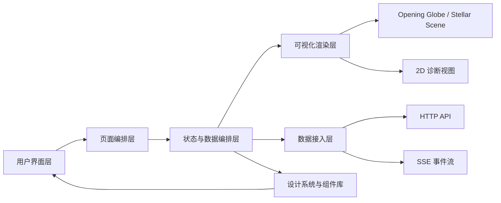
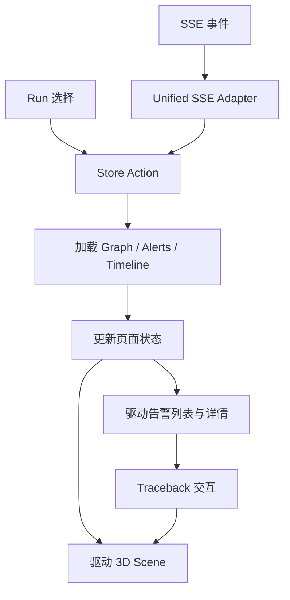
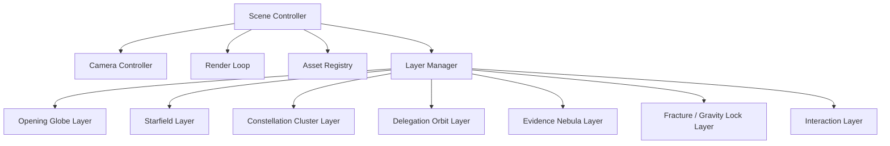
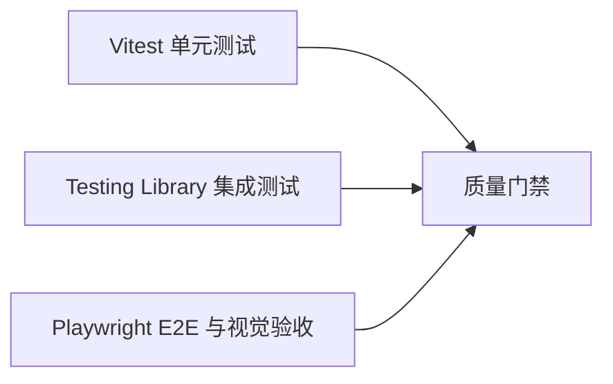

## 1. 架构设计


## 2. 技术说明
- 前端框架：Next.js 15 + React 18 + TypeScript 5
- 状态管理：Zustand
- 请求与缓存：原生 fetch + 领域数据适配层，必要时再引入查询缓存
- 样式系统：CSS Variables + 现有组件样式体系
- 3D 渲染：Three.js
- 测试体系：Vitest + Testing Library + Playwright
- 运行模式：桌面优先、SSR/静态输出兼容、真实 API 与 demo 数据双模支持

## 3. 路由定义
| 路由 | 目的 |
|------|------|
| `/` | 旗舰首页，承载地球序章、责任星空、L0 摘要与进入路径 |
| `/overview` | L0 强化版总览页，展示 cluster 排名、风险趋势与星图过滤 |
| `/clusters/[clusterId]` | L1 集群监测页，展示 cluster constellation、fan-out、证据密度与异常摘要 |
| `/agents/[agentId]` | L2 单 Agent 监测页，展示身份、委派关系、资源触达与证据摘要 |
| `/investigations/[eventId]` | L3 调查页，承载 causality chain、timeline replay、证据链和 verdict |
| `/handoff` | delegation 专题页，展示 cross-cluster handoff、fanout、drift 与 return path |
| `/diagnostics` | 系统可信度与采集健康诊断页 |

## 4. 前端模块定义
| 模块 | 职责 |
|------|------|
| `app/` | 页面路由、布局与页面级组装 |
| `components/system/` | 全局导航、布局容器、空状态、错误状态、骨架屏等系统组件 |
| `components/home/` | 地球序章、责任星空 Hero、风险摘要、进入路径等 |
| `components/overview/` | L0 总览强化视图、cluster 排名、趋势与过滤器 |
| `components/cluster/` | cluster observatory、集群摘要、证据密度、路径解释 |
| `components/agent/` | agent cockpit、身份摘要、资源接触、异常标记 |
| `components/investigation/` | causality chain、timeline、evidence 与 verdict 面板 |
| `components/handoff/` | handoff 图谱、事件流、委派树、诊断卡片等 |
| `lib/store/` | 全局 store、页面 store、selectors、事件分发与状态变更入口 |
| `lib/services/` | API、SSE、领域数据适配、消息桥接层 |
| `lib/design/` | 设计 token、主题变量、共享动画参数、图标规则 |
| `engine/` | 3D 场景初始化、相机、渲染器、资源与生命周期管理 |
| `engine/opening/` | 地球序章、粒子垂落、退场过渡逻辑 |
| `engine/stellar/` | starfield、cluster、orbit、nebula、fracture、gravity lock 图层 |
| `engine/adapters/` | 从 graph/alerts/evidence/timeline 到 3D 数据结构的映射适配器 |
| `tests/` | 单元、集成、E2E 与视觉回归测试入口 |

## 5. 状态与数据流设计


- `useAppStore`
  - 负责全局环境、当前观测会话、连接状态与公共筛选条件。
- `useOverviewStore`
  - 负责首页和 overview 的 L0 摘要、cluster 排名与主入口状态。
- `useClusterStore`
  - 负责 cluster 详情、路径高亮、证据密度与时间切片。
- `useAgentStore`
  - 负责单 agent 的身份、委派、资源与异常摘要。
- `useInvestigationStore`
  - 负责调查页的事件、时间线、证据和 verdict 状态。
- `useHandoffStore`
  - 负责 handoff 数据、事件流、选中节点、筛选条件与刷新状态。
- `useDataSync`
  - 统一接入 HTTP 初始化加载、SSE 增量更新与 demo 回退逻辑。
- `useStageBridge`
  - 负责页面状态到 opening / stellar scene 的同步，不允许页面组件直接散落调用底层消息接口。

## 6. 场景渲染架构


- `Scene Controller`
  - 管理初始化、销毁、尺寸变化、性能降级与资源释放。
- `Camera Controller`
  - 管理地球序章镜头、首页 Hero 固定视角、分析态自由视角、回放镜头与过渡动效。
- `Layer Manager`
  - 保障各图层独立维护，避免所有逻辑堆入单一脚本文件。
- `Interaction Layer`
  - 负责 hover、click、focus、高亮路径和辅助提示，不直接读写页面 DOM。

## 7. 设计系统架构
| 层级 | 说明 |
|------|------|
| 品牌层 | 产品名称、核心口号、责任场语义、视觉调性定义 |
| 令牌层 | 颜色、字号、圆角、边框、阴影、模糊、层级、动效曲线 |
| 组件层 | 按钮、卡片、状态标签、面板、列表项、导航、空状态、表单控件 |
| 页面层 | 首页模版、分析页模版、诊断页模版 |

- 首页与 handoff 页面必须共享同一套 design token。
- 页面允许有不同布局密度，但不能出现“两个产品”的视觉断裂。
- 首页、cluster、agent、investigation 必须共享同一责任词典和风险颜色语义。

## 8. 兼容性与性能策略
- 视口策略：以 1440px+ 桌面为基准，兼容 1024px 笔记本布局，移动端采用摘要化降级。
- 3D 性能策略：限制 draw call、纹理数量与粒子预算；在低性能设备上自动关闭高成本后期效果，并允许跳过 opening sequence。
- 资源策略：移除重复静态资源、缺失资源引用与未使用脚本；统一使用明确的资源清单。
- 可访问性策略：键盘焦点、ARIA 标签、颜色对比度、可见 focus ring、语义结构和状态提示。
- 兼容性目标：现代 Chromium、Safari、Firefox 的最新稳定版桌面环境。

## 9. API 与事件定义
### 9.1 HTTP 接口
| 接口 | 目的 |
|------|------|
| `GET /api/runs` | 获取可用运行列表 |
| `GET /api/runs/:id/graph` | 获取某次运行的 graph 快照 |
| `GET /api/runs/:id/alerts` | 获取某次运行的告警列表 |
| `GET /api/runs/:id/evidence` | 获取某次运行的证据链 |
| `GET /api/runs/:id/events` | 获取某次运行的事件流与时间线 |
| `GET /api/runs/:id/snapshots` | 获取状态快照 |
| `GET /api/runs/:id/diff` | 获取变化解释 |
| `GET /api/handoff/tree` | 获取委派树结构 |
| `GET /api/handoff/events` | 获取委派与边界事件流 |

### 9.2 SSE 事件
| 事件类型 | 说明 |
|----------|------|
| `alert` | 新告警或告警状态更新 |
| `graph_update` | graph 局部变化 |
| `evidence_update` | 证据密度与证据列表更新 |
| `handoff_event` | 委派行为、边界穿越或上下文传递事件 |
| `system_status` | 运行状态、连接状态、降级状态更新 |

### 9.3 TypeScript 类型边界
```ts
type AppPhase = 'idle' | 'live' | 'replay' | 'error';

interface GraphSnapshot {
  nodes: GraphNode[];
  edges: GraphEdge[];
}

interface ClusterSummary {
  id: string;
  title: string;
  severity: string;
  activeAgents: number;
}

interface InvestigationRequest {
  eventId: string;
  clusterId?: string;
  agentId?: string;
}
```

## 10. 测试架构


- 单元测试
  - Store action、selectors、cluster / agent adapters、路径推导、设计 token 规则。
- 集成测试
  - 首页到 cluster 的钻取、cluster 到 agent 的钻取、调查联动、handoff 组件交互、空状态与错误状态。
- E2E 测试
  - 首页序章切换、真实会话切换、cluster 打开、agent 打开、investigation 打开、handoff 页面筛选。
- 浏览器验收
  - 使用浏览器工具检查首页过渡、关键交互、响应式断点与控制台错误。

## 11. 实施顺序
1. 建立文档、目录、design token 与 provider 基线。
2. 建立首页、cluster、agent、investigation 的共享对象词典与数据适配层。
3. 拆分首页页面结构，完成地球序章与星空主舞台切换。
4. 新增 cluster 与 agent 页面骨架并打通路由。
5. 完善 investigation、handoff 与 diagnostics 的统一语义。
6. 补齐单元、集成、E2E 与浏览器验收。

## 12. 风险与规避
| 风险 | 影响 | 规避策略 |
|------|------|----------|
| 序章地球与星空主舞台并行期较长 | 易产生桥接不一致 | 先建立统一的 `useStageBridge` 协议，再逐步减少旧层职责 |
| 大规模 IA 重构导致主链路回归 | 首页与调查链路容易失稳 | 以首页 -> cluster -> agent -> investigation 集成测试做门禁 |
| 3D 调优消耗时间过长 | 影响整体交付节奏 | 先保分层路径正确，再做像素级视觉打磨 |
| 历史脚本中的隐式全局难以一次性清除 | 容易出现边缘 bug | 拆层时建立适配器，避免一步到位强拆造成大回归 |
