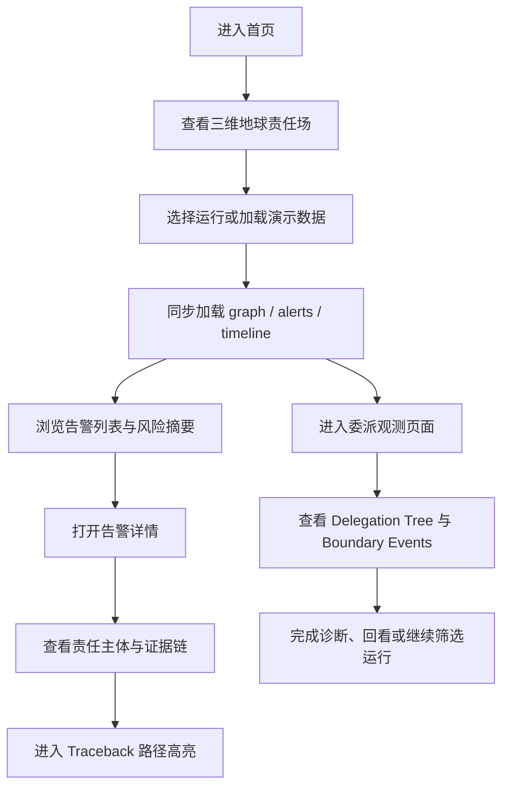

## 1. 产品概述
MtAgentLens 前端将从“Next.js 页面壳层 + legacy globe iframe + 分裂式 UI/状态流”的过渡形态，重构为一套统一、可扩展、具备旗舰视觉表现力的世界级多 Agent 可观测产品。
- 产品核心目标：以责任归因、委派链路、执行证据、边界穿越为叙事主轴，构建一个兼具战略级展示力与日常分析效率的前端系统。
- 目标价值：让 MtAgentLens 既能作为对外展示的旗舰产品首页，也能作为对内研判的高密度观测工作台，满足品牌、产品、研发与运维多类使用场景。

## 2. 核心功能

### 2.1 用户角色
| 角色 | 使用方式 | 核心权限 |
|------|----------|----------|
| 访客/演示用户 | 直接访问首页或演示环境 | 浏览首页主视觉、查看演示告警、体验责任追溯路径 |
| 研判分析用户 | 连接真实运行数据 | 查看告警流、筛选运行、分析委派链、追溯边界穿越与证据链 |
| 平台运营/产品用户 | 内部使用或路演展示 | 审阅产品状态、查看品牌叙事、演示产品能力与案例 |

### 2.2 功能模块
1. **首页责任场**：三维地球主视觉、核心叙事、中文品牌表达、运行状态入口、责任路径预览。
2. **告警研判工作台**：告警列表、详情面板、责任主体摘要、证据链与 traceback 视图。
3. **委派观测页面**：handoff 图谱、delegation tree、边界事件、扇出路径与链路摘要。
4. **运行与数据接入层**：run 选择、历史回放、实时 SSE 接入、demo 与真实数据切换。
5. **系统级视觉与交互基座**：设计 token、主题系统、动效系统、响应式布局、无障碍与兼容策略。

### 2.3 页面详情
| 页面名称 | 模块名称 | 功能描述 |
|-----------|-------------|---------------------|
| 首页 | 三维地球 Hero | 以 globe 为唯一主视觉中心，展示责任边界、委派流向、执行证据的品牌叙事 |
| 首页 | 运行概览条 | 展示当前系统状态、运行模式、实时事件强度与快速入口 |
| 首页 | 告警侧栏 | 提供告警摘要、严重级别标识、点击进入详情或 traceback |
| 首页 | 详情抽屉 | 展示单个告警的责任主体、时间线、证据引用、影响范围 |
| 首页 | Traceback 面板 | 以路径高亮方式解释边界穿越、委派链和归因理由 |
| 委派页面 | Delegation Tree | 展示主 Agent 到子 Agent 的委派拓扑与上下文关系 |
| 委派页面 | Event Rail | 展示 handoff 过程中的关键事件流与边界切换 |
| 委派页面 | Boundary Diagnostics | 解释 Policy Boundary、Context Flow、异常 fanout 与风险提示 |
| 全局 | 运行选择器 | 加载某次 run 的 graph、alerts、timeline，并驱动页面联动 |
| 全局 | 空状态与错误状态 | 为无数据、断链、加载失败、兼容降级提供清晰反馈 |

## 3. 核心流程
用户进入首页后，首先看到以三维地球为核心的责任场主视觉，理解 MtAgentLens 的产品语义与系统状态。随后用户可选择真实运行或演示运行，系统加载对应 graph 与 alerts，并同步驱动首页与委派页面的状态。用户可从告警流进入详情，再进一步打开 traceback，确认责任主体、边界穿越与证据路径。若进入 handoff 页面，则能对委派结构、扇出行为和上下文流动进行更深入分析。

## 4. 用户界面设计
### 4.1 设计风格
- 主色调：深海黑、陨石蓝黑、低饱和冰蓝、证据青白、风险琥珀、临界红。
- 按钮风格：低反光玻璃金属感按钮，强调细线边框、微内发光与明确 hover/active 层次。
- 字体策略：中文采用高端、清晰、几何气质的标题字体搭配稳定正文字体；英文技术标识保留冷静、紧致的工程感字重。
- 布局风格：桌面优先的沉浸式大画布布局，首页使用舞台式 Hero + 浮层信息架构，分析页使用高密度但层次分明的控制台式布局。
- 图标建议：使用克制、统一的线性图标与极少量强调性实心状态图标，不使用卡通或装饰性 emoji。

### 4.2 页面设计概览
| 页面名称 | 模块名称 | UI 元素 |
|-----------|-------------|-------------|
| 首页 | Hero 主视觉 | 三维地球、薄雾级环境光、贴地辉光、极低存在感网格、责任路径标记、品牌标题、系统说明 |
| 首页 | 顶部导航 | 品牌标识、页面切换、系统状态、运行控制入口 |
| 首页 | 告警列表 | 玻璃卡片、严重级别色标、时间戳、责任摘要、hover 高亮 |
| 首页 | 详情面板 | 分区标题、时间线、责任主体卡、证据引用区、操作按钮 |
| 委派页面 | 图谱区 | 深色工作台背景、结构线、节点层级、选中态边框与局部高亮 |
| 委派页面 | 侧栏 | 筛选器、事件摘要、边界说明卡、诊断提示 |
| 全局 | 状态组件 | skeleton、空状态、错误提示、重试入口、降级说明 |

### 4.3 响应式策略
- 采用桌面优先设计，首先保证 1440px 至 1920px 的旗舰体验。
- 兼容 1024px 以上笔记本视口，将多栏信息折叠为滑出式面板。
- 平板与移动端提供“观测摘要 + 关键告警 + 简化图谱/静态截图”模式，不强行保留桌面全部密度。
- 交互层支持键盘焦点顺序、屏幕阅读器语义标签和最基本的触摸目标尺寸规范。

### 4.4 3D 场景设计指引
- 环境氛围：冷静、深邃、可信赖，不做炫技式科幻噪声，不出现夸张 aurora、风暴带或廉价霓虹。
- 光照系统：以低强度环境光、边缘轮廓光、贴地信号辉光为主，避免整球泛白与过曝。
- 镜头设置：首页 Hero 固定为高辨识度亚洲半球构图，镜头稳定、克制、带极轻微呼吸感。
- 构图策略：globe 必须成为第一视觉焦点，责任路径与品牌信息围绕其展开，避免遮挡球体主体。
- 动效策略：优先使用低频、低振幅、高质感动效，如镜头微呼吸、辉光脉冲、路径渐亮、层次显隐。
- 后期效果：允许使用极轻微 bloom、vignette、颗粒与色调映射，但不得损伤文字清晰度与信号边界。
- 性能预算：桌面设备保持稳定流畅，首屏资源需控制，3D 层提供降级路径；对低性能设备允许静态替代或弱化模式。

## 5. 历史问题总表与彻底解决方案
| 问题类别 | 当前问题 | 根因 | 彻底解决方案 |
|-----------|----------|------|----------------|
| 架构 | 首页依赖 legacy iframe 与新页面双轨并存 | 历史迁移未收口 | 收敛为统一前端架构，明确 bridge 层与渲染层边界，逐步消除 legacy DOM 依赖 |
| 渲染 | globe 代码耦合严重、旧 Three.js API 过多 | 历史脚本未模块化 | 重构为可维护的场景模块、相机模块、数据映射模块与交互模块 |
| 状态流 | run 切换、SSE、traceback、graph 同步不可靠 | 页面直连状态与消息分发 | 统一状态中心、事件总线与 iframe/scene 同步协议 |
| 体验 | 首页与 handoff 页面视觉风格割裂 | 无统一设计系统 | 建立品牌级 design token、组件规范与页面模版 |
| 兼容性 | 旧脚本、旧资源与命名混乱，存在缺失资源与潜在竞态 | 历史静态资产堆积 | 清理资源、修正命名、梳理依赖，建立明确的资源目录与加载顺序 |
| 性能 | 大文件、全量脚本、重复渲染与资源浪费 | 缺乏拆分与优化策略 | 模块拆分、按需初始化、减少无效 DOM/事件、控制绘制预算 |
| 可维护性 | 首页组件与样式混杂 inline/Tailwind/legacy CSS | 缺乏工程规范与边界 | 统一组件粒度、样式系统、类型定义与测试规范 |
| 测试 | 功能测试与真实主路径脱节 | 测试重点未围绕核心链路 | 建立以首页、handoff、run 切换、SSE、traceback 为核心的全链路测试矩阵 |

## 6. 验收标准
- 首页完成旗舰级视觉重构，globe 主视觉、中文文案、状态层与告警交互统一成一个完整产品。
- 运行选择、graph 加载、告警联动、traceback 高亮、handoff 诊断形成可靠单向状态流。
- 旧 Harvard UI 痕迹、命名混乱、缺失资源、显著竞态与死代码得到系统清理。
- 组件、状态、样式与 3D 渲染代码具备可维护边界，后续新增页面或模块不再依赖复制粘贴式扩展。
- 完成功能回归、性能验证、兼容性检查与至少一轮基于浏览器的真实页面验收。

## 7. 分阶段实施计划
1. **阶段一：架构收敛与基线修复**
   - 修复首页与 handoff 的状态流断点
   - 整理 provider、store、SSE 与消息桥接
   - 建立统一的文档、目录与技术基线
2. **阶段二：首页旗舰重构**
   - 重做首页壳层、中文叙事、导航和信息架构
   - 完成三维地球 Hero 的接入与像素级调优
   - 重构告警、详情、traceback 的视觉与交互
3. **阶段三：分析页与委派页统一**
   - 重做 handoff 工作台视觉、布局与组件体系
   - 完成 delegation、boundary、event rail 的一致化设计
4. **阶段四：测试与验收**
   - 单元测试、集成测试、E2E、浏览器实机检查
   - 性能、兼容性、无障碍与降级路径验证
