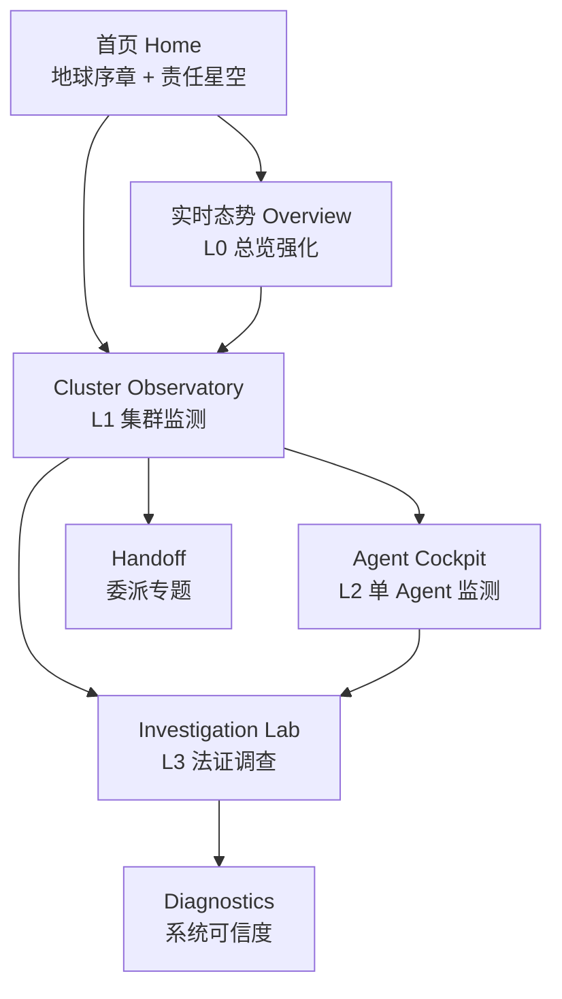
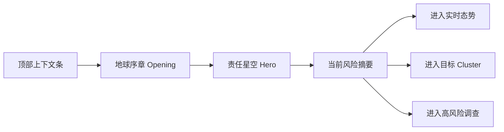
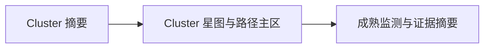
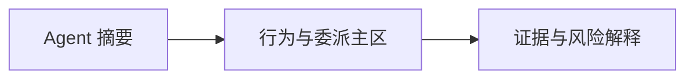

# MtAgentPrism 生产级前端信息架构

## 1. 信息架构总览

MtAgentPrism 前端采用“序章建立认知、星图承担总览、面板完成钻取”的四层结构。

四层职责：

- L0：发现哪里异常，决定从哪里进入。
- L1：解释一个 cluster 为什么危险。
- L2：解释一个 agent 到底做了什么。
- L3：解释判断为什么成立，并提供法证闭环。

## 2. 全局导航模型

### 2.1 一级导航

- 首页
- 实时态势
- Clusters
- Agents
- Investigations
- Handoff
- Diagnostics

### 2.2 全局上下文控件

所有一级页面共享以下上下文：

- 环境选择：`prod / staging / dev`
- 时间范围：`5m / 1h / 24h / custom`
- 观测会话：历史会话或当前活动会话
- 搜索 / 命令面板：cluster、agent、资源、异常、证据统一入口
- 连接与健康状态：流状态、延迟、降级模式

### 2.3 命名规范

用户可见层统一采用以下术语：

- `run` -> `观测会话`
- `alert` -> `风险事件`
- `graph` -> `责任星图`
- `traceback` -> `根因回溯`
- `demo` -> `示例场景`
- `cluster` -> `Agent 集群`

## 3. 首页信息架构

### 3.1 页面目标

首页不是大盘，不是地球展示页，而是：

- 品牌旗舰入口
- 地球序章承载记忆点
- 责任星空承载总览态势
- 通往 cluster、agent、investigation 的第一入口

### 3.2 布局结构

### 3.3 模块定义

#### 顶部上下文条

- 产品标识
- 当前环境
- 当前时间范围
- 观测会话入口
- 搜索 / 命令面板入口
- 连接状态

#### 地球序章 Opening

- 保留旧粒子垂落开场
- 作为 1.5 到 3 秒的加载起始场景
- 只承担仪式感和启动信号，不承载长期信息

#### 责任星空 Hero

- constellation cluster
- star anchor
- delegation orbit
- evidence nebula
- fracture zone
- gravity lock

#### 当前风险摘要

- 当前最值得进入的 cluster
- 当前最高优先级风险事件
- 最近 boundary crossing
- 最近 evidence surge

首页底部只保留轻量摘要，不堆叠厚重卡片。

## 4. L0 实时态势信息架构

### 4.1 页面目标

回答“现在系统里最值得优先处理的异常中心在哪里”。

### 4.2 页面布局

- 左栏：筛选器与环境上下文
- 中栏：责任星图强化视图与 cluster 排名
- 右栏：活跃风险、top routes、evidence surge

### 4.3 核心模块

- cluster ranking
- risk trend
- suspicious routes
- top active agents
- evidence density changes
- recent anomalies

## 5. L1 Cluster Observatory 信息架构

### 5.1 页面目标

回答“这个 agent 集群为什么危险，最值得继续看哪里”。

### 5.2 页面结构

### 5.3 左栏：Cluster 摘要

- cluster name
- health score
- severity
- active agents
- evidence concentration
- boundary drift
- recommended next hop

### 5.4 中栏：Cluster 星图与路径主区

- cluster constellation
- delegation fan-out
- suspicious route highlight
- recent state change
- time slice playback

### 5.5 右栏：成熟监测与证据摘要

- top suspicious agents
- top touched resources
- recent alerts
- evidence summary
- route explanation

## 6. L2 Agent Cockpit 信息架构

### 6.1 页面目标

回答“这个 agent 到底做了什么，是否应该承担关键责任”。

### 6.2 页面结构

### 6.3 左栏：Agent 摘要

- identity
- claimed role
- runtime role
- current confidence
- current severity
- cluster affiliation

### 6.4 中栏：行为与委派主区

- parent / child delegation
- active tasks
- touched resources
- anomaly markers
- recent route history

### 6.5 右栏：证据与风险解释

- supporting evidence
- boundary interactions
- policy notes
- observer / rule hints
- direct jump to investigation

## 7. L3 Investigation Lab 信息架构

### 7.1 页面目标

回答“这个风险事件到底怎么发生、凭什么成立、责任如何收束”。

### 7.2 页面结构

### 7.3 左栏：事件摘要

- 事件标题
- 严重级别
- 当前状态
- 主责任 cluster
- 主责任 agent
- 受影响资源
- 越界类型

### 7.4 中栏：责任链与时间线

- causality chain
- secondary propagation chain
- timeline replay
- state diff
- snapshot switching

### 7.5 右栏：证据与裁定

- 证据链列表
- 文件 / 网络 / 进程证据
- 规则命中
- policy explanation
- observer verdict
- confidence breakdown

### 7.6 调查页关键动作

- cluster -> 打开 cluster observatory
- agent -> 打开 agent cockpit
- 边 -> 查看传播原因
- 时间线项 -> 对应责任图状态
- 证据项 -> 原始引用与证明
- 导出 -> 调查摘要

## 8. Handoff 信息架构

### 8.1 页面目标

回答“委派链如何扇出、回收、偏移或被污染”。

### 8.2 核心模块

- handoff constellation
- fan-out score
- return path
- context drift
- cross-cluster delegation
- handoff anomaly timeline

## 9. Diagnostics 信息架构

### 9.1 页面目标

回答“系统本身是否健康，数据是否可信”。

### 9.2 核心模块

- 流完整性状态
- SSE 序列缺口
- process/tree 更新状态
- 时间线延迟
- anomaly throughput
- 降级与兼容模式

## 10. 数据到界面的直接映射

| 数据对象 | 首页 / L0 | Cluster / L1 | Agent / L2 | Investigation / L3 | Handoff | Diagnostics |
|----------|-----------|--------------|------------|--------------------|---------|-------------|
| 观测会话 | 入口摘要 | 时间上下文 | 上下文边界 | 调查上下文 | 过滤维度 | 数据范围 |
| Graph | cluster 与路径总览 | cluster constellation | agent relation | causality chain | delegation map | 结构完整性 |
| Alerts / Anomalies | risk summary | cluster risk list | agent markers | 根对象 | handoff anomalies | 风险吞吐 |
| Timeline / Events | 摘要活动 | cluster activity | agent activity | 主时间线 | handoff timeline | 延迟健康 |
| ProcessTree | 轻量摘要 | top executors | 执行上下文 | process evidence | delegation source | 过程健康 |
| Evidence | evidence surge | evidence density | supporting evidence | 主证据链 | handoff proof | 采集完整性 |
| Diff / Snapshots | 不直接暴露 | cluster evolution | local state change | 变更解释 | route evolution | 快照完整性 |

## 11. 迁移原则

### 11.1 先锁定叙事，再继续开发

先统一“地球序章 + 责任星空 + L0-L3 分层钻取”，再继续实施代码层重构。

### 11.2 首页不再承担全部详情

首页只负责发现、定位和引导，不再试图承载全部监测信息。

### 11.3 分层比炫技重要

产品价值在于层层深入地展示 cluster 和 agent，而不是单次堆叠更多三维效果。

### 11.4 视觉与工作流必须统一

首页可以更旗舰，工作台可以更密集，但所有页面都必须共享同一词汇和同一责任语义。

## 12. 验收要点

- 首页成功从“地球主视觉”切换到“地球序章 + 责任星空”。
- 一级导航和路由足以支撑 L0-L3 分层。
- cluster、agent、investigation 三层职责清晰。
- 命名、筛选、时间上下文和跳转关系一致。
- 每一类后端核心数据都在新分层结构中有明确落点。
